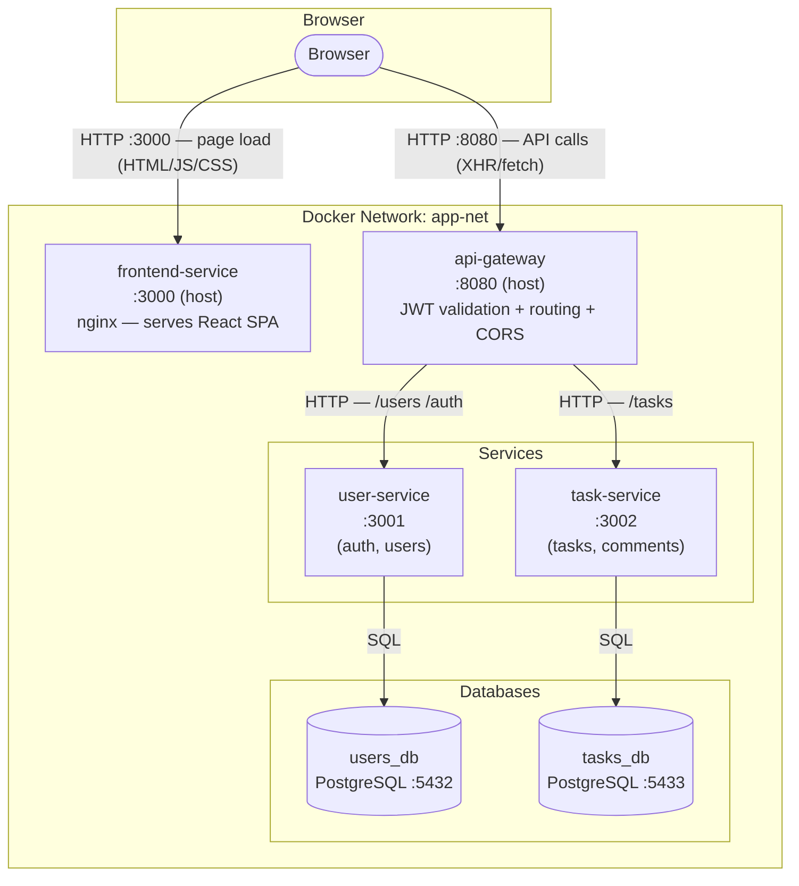
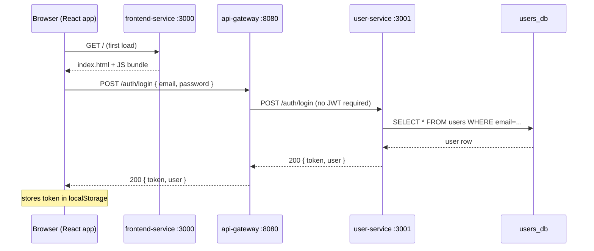
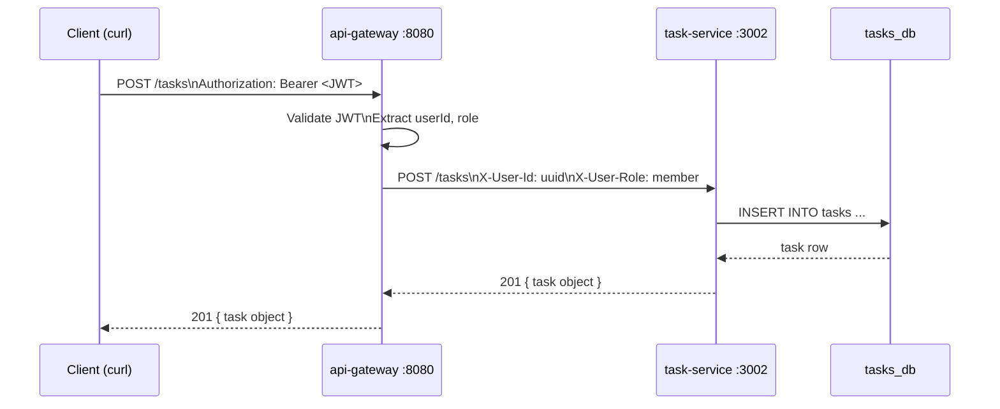

# Architecture — Task Management System

> Replace this diagram with your own project's architecture.
> Mermaid renders automatically on GitHub — paste into any `.md` file.

## System diagram

> The browser makes **two kinds of requests**: static asset requests to the nginx container on port 3000, and API requests directly to api-gateway on port 8080. The frontend container does not proxy API calls — the browser JS calls the gateway directly.

## Request flow — login via web UI

## Request flow — create a task via API (curl / Postman)

## Port map

| Service | Internal port | Host port |
|---|---|---|
| frontend-service (nginx) | 80 | **3000** |
| api-gateway | 8080 | **8080** |
| user-service | 3001 | not exposed |
| task-service | 3002 | not exposed |
| users_db (PostgreSQL) | 5432 | not exposed |
| tasks_db (PostgreSQL) | 5432 | not exposed |

**Rule:** Only `frontend-service` (port 3000) and `api-gateway` (port 8080) are exposed to the host. All other services and databases are internal to the Docker network.
