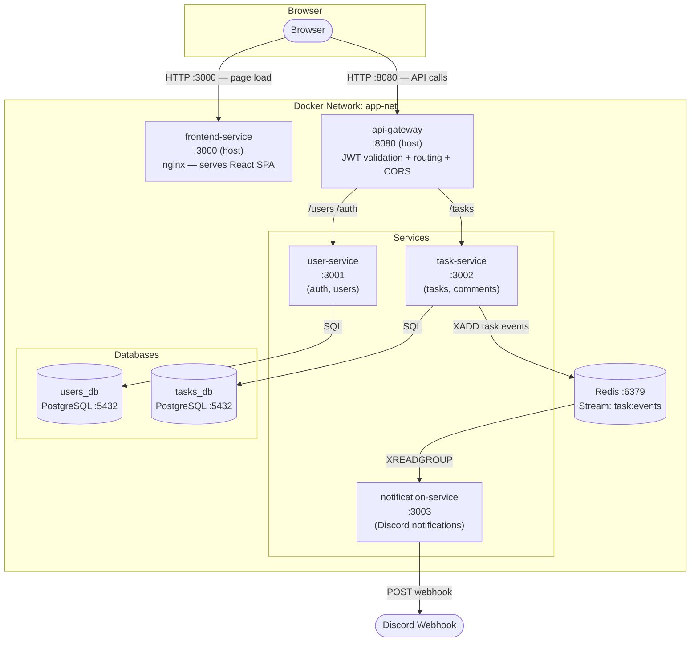
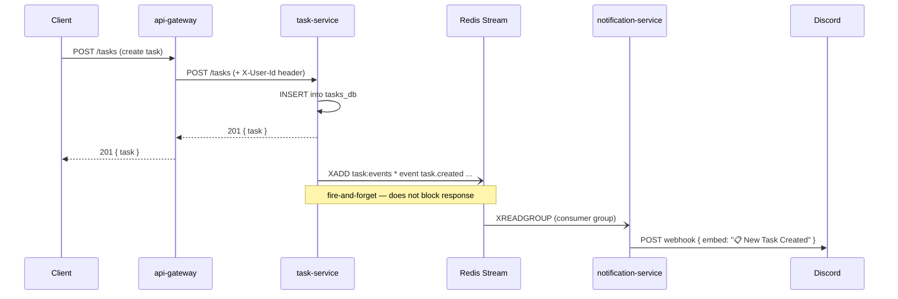
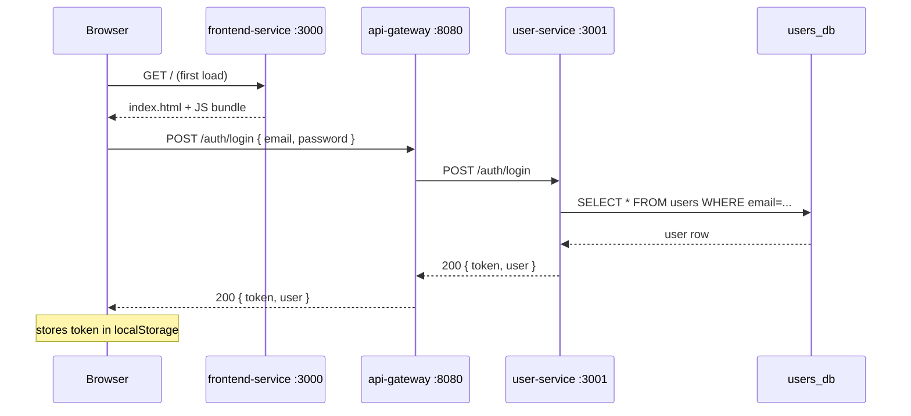
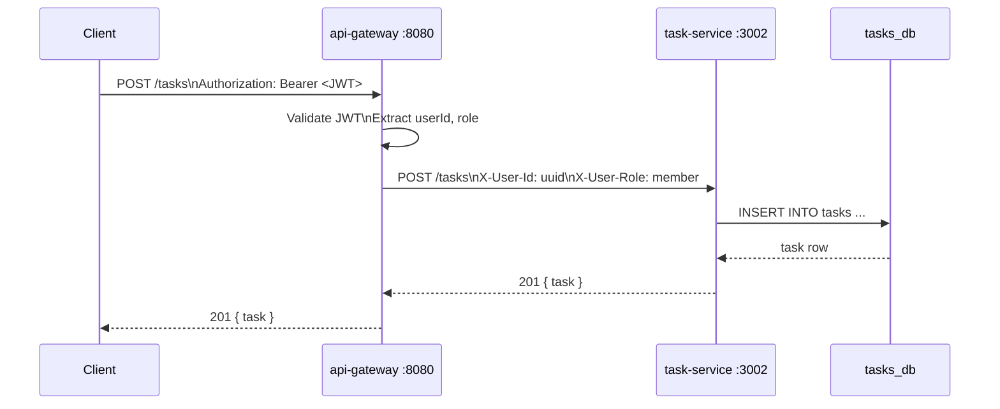

# Architecture — Task Management System

## System diagram



**Key design decision:** `notification-service` never receives HTTP calls from `api-gateway`.
It is a pure background consumer — it reads from Redis Stream and pushes to Discord.
The HTTP port (3003) exists only for Kubernetes health checks (`/health`).

---

## Event flow — notification pipeline



Events published to `task:events` stream:

| Event | Trigger |
|---|---|
| `task.created` | `POST /tasks` |
| `task.status_updated` | `PATCH /tasks/:id/status` |
| `comment.created` | `POST /tasks/:id/comments` |

---

## Request flow — login via web UI



---

## Request flow — create a task



---

## Port map

| Service | Internal port | Host port | Notes |
|---|---|---|---|
| frontend-service (nginx) | 3000 | **3000** | Serves React SPA |
| api-gateway | 8080 | **8080** | Only entry point for API |
| user-service | 3001 | not exposed | Internal only |
| task-service | 3002 | not exposed | Internal only |
| notification-service | 3003 | not exposed | Health check only |
| Redis | 6379 | not exposed | Internal only |
| users_db (PostgreSQL) | 5432 | not exposed | Internal only |
| tasks_db (PostgreSQL) | 5432 | not exposed | Internal only |

**Rule:** Only `frontend-service` and `api-gateway` are exposed to the host.
All other services, databases, and Redis are internal to the Docker/K8s network.

---

## Kubernetes layout (EKS)

```
EKS Cluster (default namespace)
├── Deployments
│   ├── frontend-service      (1 replica)
│   ├── api-gateway           (1 replica)
│   ├── user-service          (1 replica)
│   ├── task-service          (1 replica)
│   └── notification-service  (1 replica)
├── StatefulSets / Helm releases
│   ├── users-db   (PostgreSQL via manifest)
│   ├── tasks-db   (PostgreSQL via manifest)
│   └── redis      (Bitnami Helm chart → redis-master:6379)
├── Services (all ClusterIP)
│   ├── frontend-svc        :3000
│   ├── api-gw-svc          :8080
│   ├── user-svc            :3001
│   ├── task-svc            :3002
│   ├── notification-svc    :3003
│   ├── users-db-svc        :5432
│   ├── tasks-db-svc        :5432
│   └── redis-master        :6379
└── Ingress (AWS ALB)
    ├── /api  → api-gw-svc:8080
    └── /     → frontend-svc:3000
```
