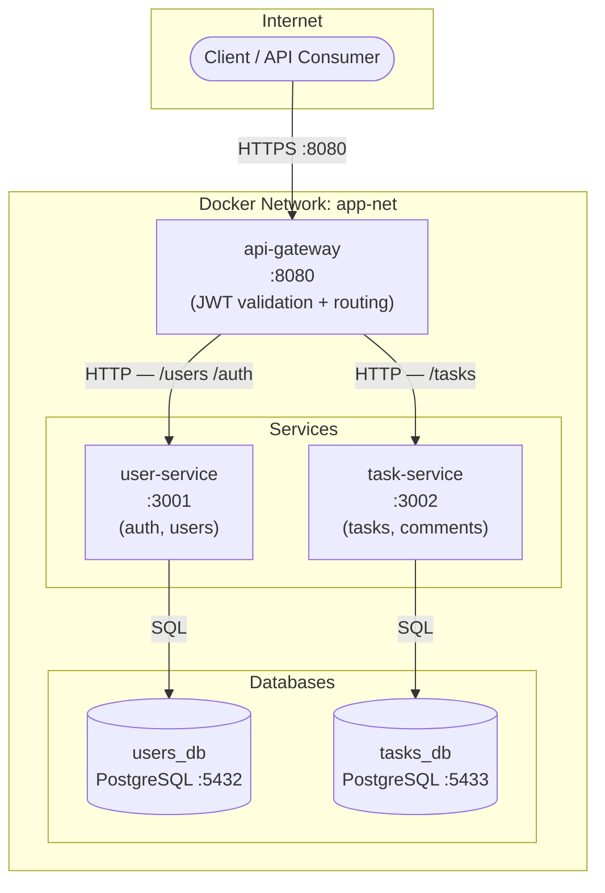
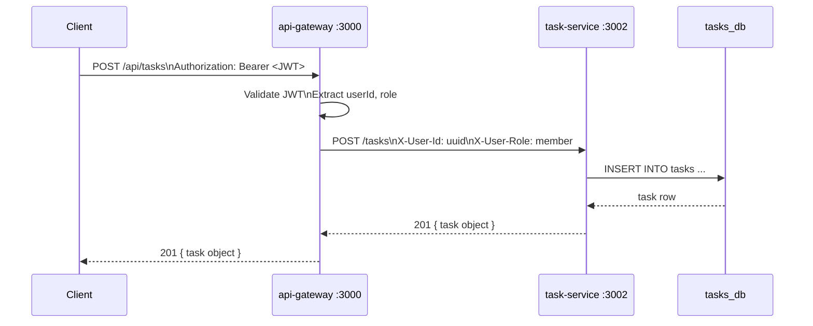

# Architecture — Task Management System

> Replace this diagram with your own project's architecture.
> Mermaid renders automatically on GitHub — paste into any `.md` file.

## System diagram

## Request flow — create a task

## Port map

| Service | Internal port | Host port (dev only) |
|---|---|---|
| api-gateway | 8080 | 8080 |
| user-service | 3001 | not exposed |
| task-service | 3002 | not exposed |
| users_db (PostgreSQL) | 5432 | not exposed |
| tasks_db (PostgreSQL) | 5432 | not exposed |

**Rule:** In production, only the gateway is exposed. Services and databases are internal to the Docker network.
