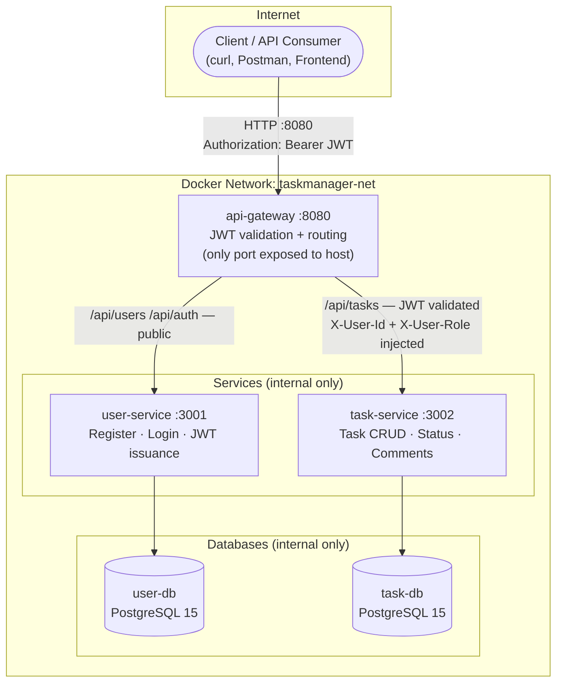

# Task Management System — Project Overview
**Team:** chau_tv + thai_dm · Week 2–8 · ProOps2026

---

## What We're Building

A REST API task tracker — like a stripped-down Jira — where teams can create, assign, and track tasks without losing context in Slack/Discord threads.

**Not a UI project.** Pure API. Focus is on microservice architecture, containerization, CI/CD, and observability.

---

## Architecture at a Glance



---

## Three Services · Three Rules

| Service | Owns | Does NOT Touch |
|---------|------|----------------|
| **user-service** | User accounts, password hashing, JWT issuance | Tasks, comments |
| **task-service** | Task CRUD, status transitions, comments | Passwords, JWT generation |
| **api-gateway** | Request routing, JWT validation, header injection | Any database |

**The iron rule:** Services never share a database. task-service stores `assignee_id` as a plain UUID — zero foreign keys across service boundaries.

---

## API Summary

### Public endpoints (no JWT required)

```
POST /api/users          → Register     → 201 { id, email, full_name, role }
POST /api/auth/login     → Login        → 200 { token, user }
```

### Protected endpoints (JWT required — api-gateway validates + injects headers)

```
POST   /api/tasks                → Create task       → 201
GET    /api/tasks                → List tasks        → 200 []
GET    /api/tasks/:id            → Get task + comments → 200
PATCH  /api/tasks/:id/status     → Update status     → 200
DELETE /api/tasks/:id            → Delete task       → 204
POST   /api/tasks/:id/comments   → Add comment       → 201
```

### Health checks (all services)

```
GET /health    → 200 { "status": "ok" }
```

---

## Data Model (simplified)

```
users (user-service)          tasks (task-service)
─────────────────────         ──────────────────────────────────
id          UUID PK           id            UUID PK
email       UNIQUE NOT NULL   title         VARCHAR(255) NOT NULL
password_hash NOT NULL        status        TODO|IN_PROGRESS|DONE|CANCELLED
full_name   NOT NULL          assignee_id   UUID (plain — no FK to users)
role        member|lead       created_by    UUID (from X-User-Id header)
created_at                    due_date      TIMESTAMP nullable
                              created_at / updated_at

                              comments (task-service)
                              ──────────────────────────
                              id, task_id FK, author_id UUID, body, created_at
```

---

## Status Transition Rules

```
TODO ──→ IN_PROGRESS ──→ DONE       (terminal — no exit)
TODO ──→ CANCELLED                  (terminal — no exit)
IN_PROGRESS ──→ CANCELLED           (terminal — no exit)
```

Any other transition → `400 { "error": "Invalid status transition" }`

---

## JWT Flow

```
1. Client → POST /api/auth/login → { token }
2. Client → GET /api/tasks  Authorization: Bearer <token>
3. api-gateway: verify token with JWT_SECRET
   → if valid: inject X-User-Id + X-User-Role, strip Authorization header
   → if invalid/expired: 401 immediately, never reaches task-service
4. task-service: read X-User-Id as created_by — never validates JWT itself
```

---

## Sprint Plan

| Sprint | Days | Goal | Owner |
|--------|------|------|-------|
| **Sprint 1** | Day 9–11 | user-service + task-service CRUD with tests | chau_tv + thai_dm |
| **Sprint 2** | Day 12–14 | api-gateway JWT middleware + Docker Compose full stack | chau_tv + thai_dm |
| **Sprint 3** | Day 15+ | CI/CD pipeline, observability, AWS deployment | chau_tv + thai_dm |

---

## Documents

| Doc | Location | Covers |
|-----|----------|--------|
| DOP-001 | Notion → DOPs | Product definition, ACs, scope |
| IRD-001 | Notion → IRDs | user-service: API, data model, validation |
| IRD-002 | Notion → IRDs | task-service: API, data model, status rules |
| IRD-003 | Notion → IRDs | api-gateway routing, JWT middleware, Docker Compose |
| architecture.md | this repo | System diagram + request flow |
| sprint-01.md | this repo | Sprint 1 backlog: Epics → Stories → Tasks |

---

## Tech Stack

```
Runtime:   Node.js 20 LTS + Express 4
Language:  TypeScript 5
Database:  PostgreSQL 15 (one per service)
Auth:      bcrypt (rounds: 12) + jsonwebtoken (HS256, 24h)
Container: Docker + Docker Compose
Network:   taskmanager-net (bridge) — only api-gateway exposed
```

---

## Key Design Decisions (locked Day 8)

1. **No shared database** — each service has its own PostgreSQL instance
2. **api-gateway is the only auth enforcer** — services trust injected headers
3. **No Redis in Sprint 1** — future sprint for async events
4. **No frontend** — API-only; test with curl/Postman
5. **Error format: `{ "error": "..." }`** — consistent across all services
6. **Port: 8080** — api-gateway external port; all other services internal-only
